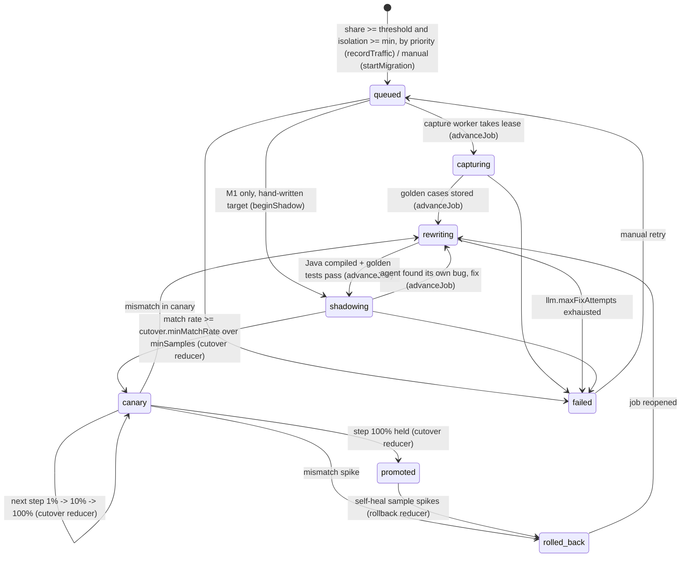

# Agent loop

> **PROPOSED.** The state machine below is the draft for team sign-off. The reducers it
> names are listed in [DATA_MODEL.md](DATA_MODEL.md).

Each pocket gets at most one active `migrationJob`. Several jobs run in parallel (up to
`traffic.maxParallelJobs`). A job's `state` changes only through a reducer, which checks
the transition table and then updates the pocket's status, its routes, and emits
`job.state_changed`.

## State machine



| State | Route mode for the pocket's endpoints | Who moves it on |
| --- | --- | --- |
| `queued` | legacy | capture worker |
| `capturing` | legacy | capture worker |
| `rewriting` | legacy | rewrite/fix worker (Nemotron Super) |
| `shadowing` | shadow | router feeds results; classify worker; cutover reducer |
| `canary` | canary (`targetPercent` = current step) | cutover reducer |
| `promoted` | target (+ self-heal sample) | rollback reducer |
| `rolled_back` | legacy | rewrite worker |
| `failed` | legacy | human |

Pocket status mirrors the job: `migrating` while active, `promoted`, back to `legacy` on
failure, `dead` when the sweep flags it. A dead pocket doesn't migrate unless traffic
revives it.

## Workers and parallelism

- Workers are stateless loops: subscribe to `migrationJob` and claim a job with a
  lease (the `worker` column, set by a reducer, so two workers can't claim the same job).
  They do the slow work outside SpacetimeDB and report back through a reducer.
- Every LLM call goes through the provider interface: `fast` (Nemotron Nano) classifies,
  summarizes, and groups; `strong` (Nemotron Super) rewrites and fixes. The model that
  wrote a rewrite never grades it (research: "keep the judge separate").
- **Waiting on a human never blocks.** A question is a row in `question`, not a job
  state. The job stays in `shadowing`. Its unresolved mismatch groups keep the match
  rate below the cutover threshold, so it simply can't advance yet. Meanwhile every
  worker keeps serving other jobs. When `answerQuestion` arrives, the reducer creates the
  decision and test and marks the group's mismatches resolved. The match rate is then
  recomputed without them.

## Which pocket goes first (D-007)

A pocket is **eligible** when it is `legacy` (not dead, no active job) and:

- its traffic share over the last `traffic.windowSimMinutes` is at least
  `traffic.thresholdShare` (share = requests whose entry program is in the pocket ÷ all
  requests, with at least `traffic.minWindowRequests` in the window), and
- its isolation is at least `ranking.minIsolation`, where
  `isolation = cohesion / (cohesion + coupling)` (1.0 for a pocket with no edges at all).

While free slots remain (`traffic.maxParallelJobs` minus active jobs), eligible pockets
start in order of

```
priority = ranking.trafficWeight × trafficShare + ranking.isolationWeight × isolation
```

Ties break by pocket id, so the order is deterministic. A hot but tangled pocket below
`minIsolation` waits. The UI shows it as "hot, too coupled" so a person can lower the bar
or start it by hand (`startMigration`). Test coverage, which the research also suggests,
is left out: CardDemo ships no tests.

## The oracle (D-015)

When old and new disagree, the verdict comes from the first rule that applies:

1. **Knowledge base.** A `decision` whose signature matches the mismatch group
   (endpoint + field paths + value shape) settles it. Only `confirmed` entries count, plus
   `proposed` ones from the code owner. The knowledge base holds expert answers from Slack
   and imported expert notes, each tagged with who said it and their authority over that
   code (owner, backup, other). If entries conflict, go to step 4.
2. **Noise / formatting.** Fields that differ between two legacy copies are noise.
   Pure formatting differences (padding, `1.0` vs `1.00`) are the agent's bug; fix the
   rewrite.
3. **Old by default.** Otherwise the old behavior is correct. The agent fixes its
   rewrite to match (back to `rewriting`, up to `llm.maxFixAttempts`). It also records an
   `assumed` decision: "assumed old is correct" plus the evidence. Assumed decisions go
   to owners in one batched digest, not as N separate questions, so anyone can overturn one later.
4. **Ask an expert instead of assuming** when any of these is true:
   - the `fast` classifier suspects a **legacy bug** (e.g. money moves against the
     customer or the bank, or the old value contradicts a knowledge-base rule);
   - knowledge-base entries **conflict**, or the only entry comes from someone without
     authority over this code, on a money path;
   - the difference touches a **money field** in a critical pocket and the old value
     can't be checked independently (research: Horizon);
   - the old code path looks **dead or deliberate** (a guard, a special case, an empty
     stub like CardDemo's `1400-COMPUTE-FEES`).

   One Slack question per group ([HUMAN_LOOP.md](HUMAN_LOOP.md)). The job keeps running.
   The answer is written to the knowledge base and turned into a test.

Classification labels per group, from `fast` (Nemotron Nano): `noise` | `formatting` |
`logic` | `legacy_bug` | `unknown`. The rewriter (`strong`) never classifies its own output.
