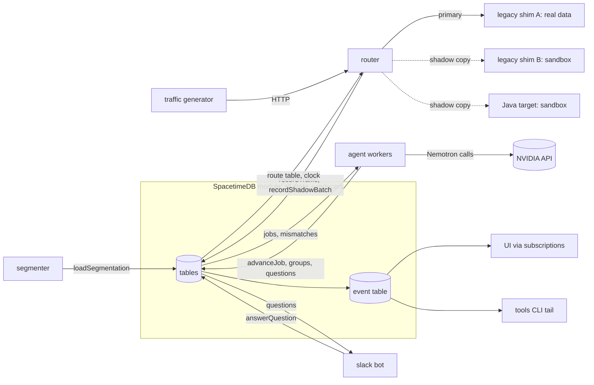

# Architecture

> **DRAFT.** Components and ownership follow the project brief. Details marked
> PROPOSED need team sign-off (see [DECISIONS.md](DECISIONS.md)).

## The one rule

SpacetimeDB holds **all** state: pockets, the code graph, jobs, traffic stats,
mismatches, questions, decisions, the routing table, the sim clock, and events. Reducers
hold the rules for every state transition. Every other process is a SpacetimeDB client.
It subscribes to the tables it needs, does outside-world work (LLM calls, compiling,
HTTP, Slack), and writes results back by calling reducers. The UI reads the same
tables through subscriptions. There is no separate REST API.

## Components

| Process | Directory | Owns (outside-world work) | Reads (subscribes) | Writes (reducers) |
| --- | --- | --- | --- | --- |
| SpacetimeDB module | `spacetime/` | state + transition rules, sim clock, triggers | n/a | n/a |
| Segmenter (CLI, run once) | `services/segmenter/` | parse legacy code, build graph, cluster | n/a | `loadSegmentation` |
| Legacy shim | `legacy/` | run CardDemo batch programs + our fixture (GnuCOBOL, or the stub) behind HTTP | n/a | n/a (plain HTTP server) |
| Target runner | `target/` | compile + run Java pockets behind HTTP | n/a | n/a (plain HTTP server) |
| Router | `services/router/` | proxy, per-endpoint counting, shadow fan-out, diff | `route`, `endpoint`, `simClock`, `noiseField`, `config` | `recordTraffic`, `recordShadowBatch` |
| Traffic generator | `services/traffic/` | synthetic requests at sim-clock-aware rates | `simClock`, `config` | `setSimClock` |
| Agent workers (M2) | `services/agent/` | capture, LLM rewrite/fix, classify, group, compose questions | `migrationJob`, `mismatch`, `decision`, … | `advanceJob`, `recordCapture`, `groupMismatches`, … |
| Slack bot (M2) | `services/slackbot/` | post questions, receive button clicks | `question` | `markQuestionSent`, `answerQuestion` |
| Tools CLI | `tools/` | print events/state, demo controls | `event` + everything | control reducers |
| UI (frontend teammate) | `web/` | rendering; today runs on `MockSource` + a segmenter snapshot, no backend | all public tables → Zustand (planned) | none planned |

## Data flow

## Request path through the router (PROPOSED)

1. Match the request to a catalogued endpoint. Add 1 to that endpoint's count for the
   current sim-minute bucket. Counts are flushed in one `recordTraffic` call per
   `traffic.flushMs`, never one call per request.
2. Look up the endpoint's `route.mode`:
   - `legacy`: forward to legacy shim A and return its response.
   - `shadow`: forward to A and return A's response. Then send the same request to
     legacy shim B and the Java target, both on sandboxed data. Diff the responses.
     Fields where A and B differ are noise (Diffy's technique). Flush counts,
     mismatches and noise fields via `recordShadowBatch`.
   - `canary`: `targetPercent`% of requests are answered by the target; the rest go
     through `shadow`.
   - `target`: the target answers. A `selfHeal.samplePercent` sample still runs shadow.
3. Sandbox isolation (PROPOSED, D-010): before forwarding to A, the router asks it to
   snapshot its data file. B and the target load that snapshot before handling the
   request, so all three see the same pre-request state. Only A's writes are kept.

## Legacy sources (D-014, D-018)

- **AWS CardDemo** (`legacy/carddemo/`, pinned, gitignored; `pnpm legacy:fetch`). We
  segment all of it. Its 17 online programs need CICS, so they appear in the graph but
  don't run locally (Q16). Its 14 batch programs (interest, posting, statements, …)
  are candidates to run under GnuCOBOL (spike Q15) and are exposed as HTTP endpoints.
- **Our fixture** (`legacy/fixture/`): a few runnable request/response transactions
  covering what CardDemo lacks: an overpaying legacy bug, a real rule that looks dead,
  and a transaction nobody calls. It reuses CardDemo copybooks where possible.

## Adapters (the only abstractions we add)

- `LegacyRuntime`: `invoke(request) -> response` for one legacy transaction.
  Implementations: GnuCOBOL binaries (CardDemo batch + fixture), and a TypeScript stub
  with the same quirks for machines without GnuCOBOL.
- `TargetRuntime`: build/start/invoke the migrated code. Implementation: Java (plain
  JDK), recommended in D-013. TypeScript inside SpacetimeDB stays possible behind the same adapter.
- LLM provider: `complete({role: 'fast'|'strong', messages, tools})`. Implementations:
  NVIDIA (OpenAI-compatible), mock, and a record/replay cache keyed by prompt hash.
- Language extractor: one per legacy language; COBOL first. See [SEGMENTATION.md](SEGMENTATION.md).

## Ports and names (from `theseus.config.json`)

| Thing | Value |
| --- | --- |
| SpacetimeDB | `ws://localhost:3000`, database `theseus` |
| Router | `:8080` |
| Legacy shim A (real data) / B (noise copy) | `:7001` / `:7002` |
| Java target runner | `:7101` |

## Versions verified (2026-11-07)

- SpacetimeDB CLI and `spacetimedb` npm package **2.14.1** (pinned together; the
  bindings record the CLI version). Docker image `clockworklabs/spacetime:v2.14.1`.
- NVIDIA API base URL `https://integrate.api.nvidia.com/v1` (OpenAI-compatible).
  Model IDs in [DECISIONS.md](DECISIONS.md) D-008.
